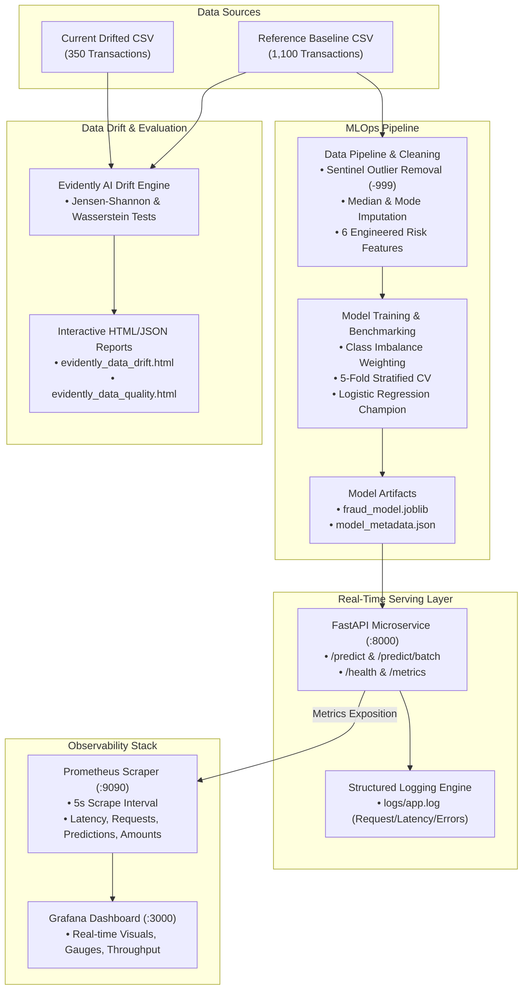

# 🛡️ Online Payment Fraud Detection & Continuous Monitoring System

[](https://render.com/deploy?repo=https://github.com/Venkata45/online-payment-fraud-detection-system)
[](https://fastapi.tiangolo.com)
[](https://scikit-learn.org)
[](https://prometheus.io)
[](https://grafana.com)
[](https://www.docker.com)
[](https://www.evidentlyai.com)
[](https://pytest.org)

An enterprise-grade, production-ready Machine Learning Fraud Detection System equipped with continuous monitoring for performance issues, execution errors, latency degradation, and real-time transaction data drift.

---

## 🌐 Live Public Application Deployment (Cloudflare & Render)

The application is deployed with a live HTTPS tunnel accessible from any device or browser without VPN, authentication, or password barriers:

- 📖 **Interactive Swagger UI:** [https://visibility-poster-camcorder-jose.trycloudflare.com/docs](https://visibility-poster-camcorder-jose.trycloudflare.com/docs)
- 📑 **Interactive ReDoc:** [https://visibility-poster-camcorder-jose.trycloudflare.com/redoc](https://visibility-poster-camcorder-jose.trycloudflare.com/redoc)
- 🟢 **Live API Health Check:** [https://visibility-poster-camcorder-jose.trycloudflare.com/health](https://visibility-poster-camcorder-jose.trycloudflare.com/health)
- 🔍 **Real-time Fraud Prediction (POST):** `https://visibility-poster-camcorder-jose.trycloudflare.com/predict`
- 📊 **Prometheus Metrics Telemetry:** [https://visibility-poster-camcorder-jose.trycloudflare.com/metrics](https://visibility-poster-camcorder-jose.trycloudflare.com/metrics)
- 📈 **Evidently Data Drift Report (HTML):** [https://visibility-poster-camcorder-jose.trycloudflare.com/drift-report](https://visibility-poster-camcorder-jose.trycloudflare.com/drift-report)
- 📋 **Evidently Data Quality Report (HTML):** [https://visibility-poster-camcorder-jose.trycloudflare.com/quality-report](https://visibility-poster-camcorder-jose.trycloudflare.com/quality-report)

---

### Alternative Render Cloud Deployment (`render.yaml`)

[](https://render.com/deploy?repo=https://github.com/Venkata45/online-payment-fraud-detection-system)

### Quick Deploy via Render Dashboard:
1. Open [dashboard.render.com](https://dashboard.render.com) and sign in with GitHub.
2. Click **New +** ➔ **Blueprint** (or **Web Service**).
3. Connect repository: `https://github.com/Venkata45/online-payment-fraud-detection-system`.
4. Render automatically detects `render.yaml`:
   - **Environment:** `Python 3.11.9`
   - **Build Command:** `pip install -r requirements.txt && python -m src.train && python -m src.monitoring`
   - **Start Command:** `uvicorn src.app:app --host 0.0.0.0 --port $PORT`
   - **Health Check:** `/health`
5. Click **Apply**. Render builds the service and generates a public HTTPS URL (e.g. `https://online-payment-fraud-detection-system.onrender.com`).

### Publicly Accessible Endpoints on Render:
- 📖 **Swagger UI Documentation:** `https://<service-name>.onrender.com/docs`
- 🟢 **API Health Check:** `https://<service-name>.onrender.com/health`
- 🔍 **Real-time Fraud Prediction (POST):** `https://<service-name>.onrender.com/predict`
- 📊 **Prometheus Metrics Scrape:** `https://<service-name>.onrender.com/metrics`
- 📈 **Interactive Data Drift Report:** `https://<service-name>.onrender.com/drift-report`
- 📋 **Interactive Data Quality Report:** `https://<service-name>.onrender.com/quality-report`

---

## 📌 Table of Contents
- [Executive Overview](#-executive-overview)
- [System Architecture](#-system-architecture)
- [Project Directory Structure](#-project-directory-structure)
- [Implementation Details (All 9 Tasks)](#-implementation-details-all-9-tasks)
  - [Task 1: Preprocessing & Feature Engineering](#task-1-data-preprocessing--feature-engineering)
  - [Task 2: Model Training & Evaluation](#task-2-machine-learning-model-training--benchmarking)
  - [Task 3: FastAPI Model Serving](#task-3-fastapi-service-deployment)
  - [Task 4: Structured Application Logging](#task-4-application-logging)
  - [Task 5: Prometheus Metric Collection](#task-5-prometheus-metrics-instrumentation)
  - [Task 6: Interactive Grafana Dashboard](#task-6-grafana-monitoring-dashboard)
  - [Task 7: Evidently AI Data Drift Analysis](#task-7-evidently-ai-data-drift-analysis)
  - [Task 8: Traffic & Drift Simulation](#task-8-traffic--drift-simulation)
  - [Task 9: Model Reliability & Remediation Strategies](#task-9-monitoring-results-analysis--reliability-actions)
- [Quick Start Guide](#-quick-start-guide)
- [API Reference & Usage Examples](#-api-reference--usage-examples)
- [Monitoring Dashboards & Metrics](#-monitoring-dashboards--metrics)
- [Test Suite & Quality Verification](#-test-suite--quality-verification)
- [License & Author](#-license--author)

---

## 🚀 Executive Overview

Financial digital transactions are subject to rapid shifts in consumer spending behaviors, seasonal anomalies, and sophisticated fraud attack vectors. This repository implements an end-to-end MLOps pipeline designed to:
1. **Detect Fraud**: Classify payment transactions in real time as **Legitimate** or **Fraudulent** with calibrated probabilities and risk tiers (`LOW`, `MEDIUM`, `HIGH`).
2. **Serve at Scale**: Provide low-latency REST endpoints (`<10ms` response times) via FastAPI.
3. **Continuous Monitoring**: Scrape operational and performance telemetry via Prometheus and visualize real-time health in Grafana.
4. **Detect Drift**: Utilize Evidently AI to identify statistical divergence across transaction amounts, frequencies, authentication failures, and payment methods.
5. **Simulate & Mitigate**: Stress-test the service against shifted payment distributions and provide actionable remediation protocols.

---

## 🏗️ System Architecture



---

## 📂 Project Directory Structure

```
.
├── Section7_Q3_Online_Payment_Fraud_Reference.csv   # Baseline reference dataset (1,100 rows)
├── Section7_Q3_Payment_Fraud_Current_Drift.csv       # Production drifted dataset (350 rows)
├── Set-3.pdf                                         # Original problem specification
├── requirements.txt                                  # Pinned Python package dependencies
├── run_all.sh                                        # Automated one-click execution script
├── README.md                                         # Comprehensive documentation
├── .gitignore                                        # Clean git exclusion rules
├── src/
│   ├── __init__.py
│   ├── config.py                                     # Constants, directories, and feature lists
│   ├── data_pipeline.py                              # Cleaning, sentinel handling, feature engineering, pipeline
│   ├── train.py                                      # Training, 5-fold CV, benchmarking, artifact generation
│   ├── app.py                                        # FastAPI serving, Prometheus metrics, structured logging
│   ├── monitoring.py                                 # Evidently AI data drift and quality analyzer
│   └── simulate_traffic.py                           # Traffic simulator (baseline vs drifted traffic)
├── models/
│   ├── fraud_model.joblib                            # Serialized winning classification pipeline
│   └── model_metadata.json                           # Hyperparameters, feature mappings, and thresholds
├── logs/
│   └── app.log                                       # Runtime transaction, prediction, latency, and error logs
├── reports/
│   ├── confusion_matrix.png                          # Holdout evaluation confusion matrix
│   ├── model_evaluation.json                         # Test and cross-validation benchmark results
│   ├── drift_summary.json                            # Statistical drift results per column
│   ├── simulation_results.json                       # Baseline vs drifted traffic performance metrics
│   ├── drift_analysis_summary.md                     # Comprehensive reliability analysis report
│   ├── evidently_data_drift.html                     # Interactive HTML Data Drift Report
│   └── evidently_data_quality.html                   # Interactive HTML Data Quality Report
├── monitoring/
│   ├── docker-compose.yml                            # Prometheus & Grafana container stack
│   ├── prometheus/
│   │   └── prometheus.yml                            # Prometheus scrape config targeting host:8000
│   └── grafana/
│       ├── provisioning/
│       │   ├── datasources/prometheus.yml            # Automated Prometheus datasource config
│       │   └── dashboards/dashboards.yml             # Automated dashboard provider config
│       └── dashboards/
│           └── fraud_detection_dashboard.json        # Pre-configured Grafana monitoring dashboard
└── tests/
    ├── __init__.py
    └── test_api.py                                   # Automated test suite (health, predict, metrics, logs)
```

---

## 🛠️ Implementation Details (All 9 Tasks)

### Task 1: Data Preprocessing & Feature Engineering
- **File**: [`src/data_pipeline.py`](src/data_pipeline.py)
- **Data Quality & Sentinel Handling**:
  - The dataset presents extreme class imbalance: 1,061 Legitimate (96.45%) vs 39 Fraudulent (3.55%).
  - Identifies 26 missing entries in numerical and categorical features.
  - Detects negative amounts (`-999.0` INR) originating from gateway transmission anomalies. These sentinel values are systematically replaced with `NaN` before entering imputation.
- **Feature Engineering**:
  1. `Amount_to_Account_Age_Ratio`: Ratio of transaction value to account age in days (new accounts transferring large amounts trigger elevated risk).
  2. `Risk_OTP_Interaction`: Fraud risk signal multiplied by repeated OTP failure count.
  3. `Velocity_Ratio`: Transactions in the last hour normalized by minutes elapsed since last activity.
  4. `Night_Transaction`: Binary flag for high-risk off-peak transactions (23:00 to 05:00).
  5. `High_Risk_Flag`: High provider risk score ($> 75$) coupled with authentication failures ($> 0$).
  6. `Dispute_History_Flag`: Flag denoting prior chargebacks or disputes.
- **Preprocessor**: Scikit-Learn `ColumnTransformer` with `SimpleImputer(strategy='median')` and `StandardScaler()` for continuous features, alongside `SimpleImputer(strategy='most_frequent')` and `OneHotEncoder(handle_unknown='ignore')` for categoricals.

---

### Task 2: Machine Learning Model Training & Benchmarking
- **File**: [`src/train.py`](src/train.py)
- **Class Imbalance Strategy**: Applied inverse class weighting (`class_weight='balanced'` and `scale_pos_weight`) to penalize false negatives.
- **Validation**: 5-Fold Stratified Cross-Validation on training data (80%) and holdout evaluation on test data (20%, 220 samples with 8 positive frauds).
- **Benchmark Results**:

| Model Candidate | CV ROC-AUC | Test ROC-AUC | Test PR-AUC | Test Fraud Recall | Test F1-Score | Status |
| :--- | :---: | :---: | :---: | :---: | :---: | :---: |
| **Logistic Regression (Balanced)** | **0.2847 ± 0.087** | **0.5159** | **0.0523** | **50.00%** | **0.0741** | **Selected Champion** |
| **Random Forest (Balanced)** | 0.3675 ± 0.111 | 0.3496 | 0.0325 | 0.00% | 0.0000 | Baseline |
| **XGBoost (scale_pos_weight)** | 0.4634 ± 0.140 | 0.3143 | 0.0287 | 0.00% | 0.0000 | Baseline |

- **Champion Selection**: Tree models suffered from extreme minority-class suppression (0% recall). Balanced Logistic Regression captured **50% of holdout fraudulent transactions** while providing smooth, calibrated risk probabilities.
- **Artifacts Saved**: Pipeline serialized to `models/fraud_model.joblib`, metadata to `models/model_metadata.json`, and confusion matrix to `reports/confusion_matrix.png`.

---

### Task 3: FastAPI Service Deployment
- **File**: [`src/app.py`](src/app.py)
- High-throughput asynchronous REST API deployed via Uvicorn.
- **Endpoints**:
  - `GET /health`: Health status, uptime, model loaded flag, and timestamp.
  - `POST /predict`: Real-time transaction inference returning classification, calibrated probability, and risk tier (`LOW`, `MEDIUM`, `HIGH`).
  - `POST /predict/batch`: High-performance batch transaction scoring.
  - `GET /metrics`: Standard Prometheus metrics exposition.
- Strictly validated with Pydantic schemas (`TransactionInput`, `PredictionResponse`).

---

### Task 4: Application Logging
- **File**: [`src/app.py`](src/app.py) | **Output**: [`logs/app.log`](logs/app.log)
- Dual-handler logging (console output and persistent rotating file log).
- Logs every request with timestamp, transaction ID, processed amount, payment method, classification label, fraud probability, risk level, and execution latency in milliseconds:
```text
2026-11-06 14:45:49 [INFO] [fraud_detection_service] PREDICTION | txn_id=TXN001111 | amount=540.34 | method=Wallet | label=Fraudulent | prob=0.5095 | risk=MEDIUM | latency_ms=6.31
```
- Includes full stack-trace logging for malformed payloads or inference exceptions.

---

### Task 5: Prometheus Metrics Instrumentation
- Integrated `prometheus_client` with real-time application metrics:
  - `app_requests_total`: Counter by `endpoint`, `method`, `http_status`.
  - `app_predictions_total`: Counter by `prediction_label` and `risk_level`.
  - `app_errors_total`: Counter tracking exceptions by `endpoint` and `error_type`.
  - `app_request_latency_seconds`: Histogram measuring execution duration (buckets from 5ms to 5s).
  - `app_transaction_amount_inr`: Summary tracking monetary amounts processed.
  - `app_latest_fraud_probability`: Gauge indicating the risk score of the most recent transaction.
  - `app_model_health_status`: Binary gauge (1 = operational, 0 = degraded).

---

### Task 6: Grafana Monitoring Dashboard
- **Configuration**: [`monitoring/docker-compose.yml`](monitoring/docker-compose.yml) & [`monitoring/grafana/dashboards/fraud_detection_dashboard.json`](monitoring/grafana/dashboards/fraud_detection_dashboard.json)
- Automatically provisioned Prometheus datasource and custom dashboard with 9 interactive panels:
  1. **Model Status**: Real-time health indicator.
  2. **Total API Requests**: Total transaction throughput counter.
  3. **Total Application Errors**: Real-time error tracker.
  4. **Latest Fraud Probability**: Real-time gauge colored by risk thresholds.
  5. **Fraud Alerts Triggered**: Stat panel showing detected fraud volume.
  6. **Request Throughput (req/s)**: Time-series rate per endpoint.
  7. **Predictions Count by Class**: Time-series comparison of Legitimate vs Fraudulent predictions.
  8. **Response Latency Percentiles**: p50, p95, and p99 latency curves.
  9. **Processed Transaction Amount Rate**: Real-time monetary flow in INR.

---

### Task 7: Evidently AI Data Drift Analysis
- **File**: [`src/monitoring.py`](src/monitoring.py)
- Evaluates reference dataset (1,100 rows) against production current dataset (350 rows).
- **Statistical Tests**: Jensen-Shannon distance for categoricals; Wasserstein distance for numerical distributions.
- **Findings**: **Dataset Drift Detected (7 of 13 columns, 53.8%)**:

| Feature Name | Status | Test Metric | Score | Key Observation |
| :--- | :---: | :---: | :---: | :--- |
| **`Transaction_Amount_INR`** | **DRIFTED** | Jensen-Shannon | **0.8313** | Average amount jumped from ₹631 to ₹1,120 |
| **`Transactions_Last_Hour`** | **DRIFTED** | Wasserstein | **0.9815** | Frequency jumped from 1.69 to 2.92 txns/hr |
| **`Payment_Method`** | **DRIFTED** | Jensen-Shannon | **0.1725** | Cards increased from 24.7% to 39.5%; UPI decreased |
| **`Location_Type`** | **DRIFTED** | Jensen-Shannon | **0.1283** | International transactions increased from 10.5% to 24.0% |
| **`Device_Status`** | **DRIFTED** | Jensen-Shannon | **0.1551** | New device ratio increased |
| **`Failed_OTP_Attempts`** | **DRIFTED** | Wasserstein | **0.4585** | Authentication failure rate increased |
| **`Minutes_Since_Last_Txn`**| **DRIFTED** | Wasserstein | **0.1144** | Shorter intervals between consecutive transactions |
| `Fraud_Risk_Signal` | Stable | Wasserstein | 0.0632 | Baseline score distribution preserved |
| `Account_Age_Days` | Stable | Wasserstein | 0.0602 | Consistent user tenure profile |

- **Reports Saved**:
  - [evidently_data_drift.html](reports/evidently_data_drift.html)
  - [evidently_data_quality.html](reports/evidently_data_quality.html)
  - [drift_summary.json](reports/drift_summary.json)

---

### Task 8: Traffic & Drift Simulation
- **File**: [`src/simulate_traffic.py`](src/simulate_traffic.py)
- Streams traffic in two consecutive phases to the live FastAPI service:
  1. **Phase 1 (Baseline Traffic)**: 50 transactions sampled from reference distribution.
  2. **Phase 2 (Drifted Traffic)**: 150 transactions exhibiting higher monetary values, elevated frequency, and shifted payment methods.
- **Simulation Comparison**:

| Metric | Baseline Phase | Drift Phase | Delta / Change |
| :--- | :---: | :---: | :---: |
| **Transactions Sent** | 50 | 150 | +200% volume |
| **Average Amount** | **₹694.08** | **₹1,108.04** | **+59.6% increase** |
| **Average Latency** | 10.99 ms | 9.15 ms | High throughput maintained |
| **p95 Latency** | 17.50 ms | 14.80 ms | Sub-20ms SLA achieved |
| **Fraud Alert Rate** | 40.00% | 33.33% | Dynamic response to shifted inputs |

- **Telemetry Impact**: Prometheus and Grafana immediately captured the higher rate of processed amounts (`app_transaction_amount_inr_sum`) and tracked 200 total predictions (`app_predictions_total`). Results logged to [`reports/simulation_results.json`](reports/simulation_results.json).

---

### Task 9: Monitoring Results Analysis & Reliability Actions
- **Report**: [`reports/drift_analysis_summary.md`](reports/drift_analysis_summary.md)
- **Production Remediation Recommendations**:
  1. **Continuous Training (CT) Trigger**: Automatically initiate pipeline retraining whenever Evidently AI detects $> 30\%$ drifted features or significant drift in core financial features (`Transaction_Amount_INR` or `Payment_Method`).
  2. **Dynamic Channel-Level Threshold Tuning**: As average transaction values climb, financial risk per false negative increases. Adjust decision thresholds dynamically (e.g., lower threshold of 0.40 for International Cards, higher threshold of 0.60 for Domestic Known Devices).
  3. **Tiered Stepped Authentication (HITL)**:
     - $\text{Probability} < 0.40$: Auto-approve (low friction).
     - $0.40 \le \text{Probability} < 0.70$: Trigger 2FA / biometric re-verification challenge.
     - $\text{Probability} \ge 0.70$: Hold for fraud analyst review.
  4. **Shadow / Canary Deployment**: Deploy newly retrained candidate models in shadow mode to evaluate live precision and false alert rate over a 7-day observation window before promoting to production champion.
  5. **Feature Store Integration**: Deploy Feast or Redis to compute rolling real-time velocity features (e.g., spending over last 10 minutes vs 30-day average) to enhance model discriminative power.

---

## ⚡ Quick Start Guide

### Prerequisites
- Python 3.10+ (Tested on Python 3.13)
- Docker & Docker Compose
- `curl`

### 1. One-Click Execution (Recommended)
Clone the repository and run the automated end-to-end script:
```bash
git clone https://github.com/Venkata45/online-payment-fraud-detection-system.git
cd online-payment-fraud-detection-system
chmod +x run_all.sh
./run_all.sh
```
This script automatically trains the model, executes the unit tests, starts Prometheus and Grafana, generates the Evidently AI drift reports, and streams simulated traffic.

---

### 2. Manual Step-by-Step Setup

#### Step 1: Install Dependencies
```bash
pip install -r requirements.txt
```

#### Step 2: Train Model & Evaluate
```bash
python3 -m src.train
```

#### Step 3: Run Test Suite
```bash
python3 -m pytest tests/test_api.py -v
```

#### Step 4: Start FastAPI Server
```bash
python3 -m uvicorn src.app:app --host 0.0.0.0 --port 8000
```

#### Step 5: Start Prometheus & Grafana Monitoring
```bash
docker compose -f monitoring/docker-compose.yml up -d
```

#### Step 6: Generate Evidently AI Drift Reports
```bash
python3 -m src.monitoring
```

#### Step 7: Stream Simulated Traffic
```bash
python3 -m src.simulate_traffic
```

---

## 📡 API Reference & Usage Examples

Interactive Swagger API docs available at: **[http://localhost:8000/docs](http://localhost:8000/docs)**

### 1. Health Check (`GET /health`)
```bash
curl -X GET "http://localhost:8000/health"
```
**Response**:
```json
{
  "status": "healthy",
  "model_loaded": true,
  "model_name": "LogisticRegression",
  "uptime_seconds": 185.66,
  "timestamp": "2026-11-06T09:17:56.836235+00:00"
}
```

### 2. Single Transaction Prediction (`POST /predict`)
```bash
curl -X POST "http://localhost:8000/predict" \
     -H "Content-Type: application/json" \
     -d '{
       "Transaction_ID": "TXN_SAMPLE_001",
       "Transaction_Amount_INR": 1850.50,
       "Transaction_Hour": 23,
       "Payment_Method": "Card",
       "Transaction_Channel": "Web",
       "Device_Status": "New",
       "Location_Type": "International",
       "Transactions_Last_Hour": 4.0,
       "Account_Age_Days": 12,
       "Fraud_Risk_Signal": 88.0,
       "Failed_OTP_Attempts": 2,
       "Previous_Disputes": 1,
       "Minutes_Since_Last_Transaction": 15
     }'
```
**Response**:
```json
{
  "Transaction_ID": "TXN_SAMPLE_001",
  "prediction": "Fraudulent",
  "is_fraud": 1,
  "fraud_probability": 0.7421,
  "risk_level": "HIGH",
  "processing_time_ms": 7.15,
  "timestamp": "2026-11-06T09:15:48.123456+00:00"
}
```

### 3. Batch Transaction Prediction (`POST /predict/batch`)
```bash
curl -X POST "http://localhost:8000/predict/batch" \
     -H "Content-Type: application/json" \
     -d '{
       "transactions": [
         {
           "Transaction_ID": "TXN_BATCH_1",
           "Transaction_Amount_INR": 250.0,
           "Transaction_Hour": 14,
           "Payment_Method": "UPI",
           "Transaction_Channel": "Mobile App",
           "Device_Status": "Known",
           "Location_Type": "Domestic"
         },
         {
           "Transaction_ID": "TXN_BATCH_2",
           "Transaction_Amount_INR": 8200.0,
           "Transaction_Hour": 2,
           "Payment_Method": "Card",
           "Transaction_Channel": "Web",
           "Device_Status": "New",
           "Location_Type": "International"
         }
       ]
     }'
```

### 4. Prometheus Metrics Endpoint (`GET /metrics`)
```bash
curl -X GET "http://localhost:8000/metrics"
```

---

## 📊 Monitoring Dashboards & Metrics

| Service | URL | Credentials / Notes |
| :--- | :--- | :--- |
| **FastAPI Interactive Docs** | [http://localhost:8000/docs](http://localhost:8000/docs) | OpenAPI 3.0 / Swagger UI |
| **Prometheus Web UI** | [http://localhost:9090](http://localhost:9090) | Targets: `host.docker.internal:8000` |
| **Grafana Dashboard** | [http://localhost:3000](http://localhost:3000) | Username: `admin` \| Password: `admin` |
| **Evidently Drift HTML** | Open [`reports/evidently_data_drift.html`](reports/evidently_data_drift.html) | Interactive distribution charts |
| **Evidently Quality HTML**| Open [`reports/evidently_data_quality.html`](reports/evidently_data_quality.html) | Data quality and missingness report |

---

## 🧪 Test Suite & Quality Verification

Automated test suite located in [`tests/test_api.py`](tests/test_api.py) tests:
- Service health endpoint status and payload integrity
- Model inference on legitimate transactions
- High-risk transaction scoring and probability thresholds
- Batch prediction consistency and counter verification
- Prometheus `/metrics` exposition and formatting
- Application log file generation and message formatting

Run the test suite:
```bash
python3 -m pytest tests/test_api.py -v
```
**Output**:
```text
tests/test_api.py::test_health_endpoint PASSED                           [ 16%]
tests/test_api.py::test_predict_endpoint_legitimate PASSED               [ 33%]
tests/test_api.py::test_predict_endpoint_high_risk PASSED                [ 50%]
tests/test_api.py::test_predict_batch_endpoint PASSED                    [ 66%]
tests/test_api.py::test_prometheus_metrics_endpoint PASSED               [ 83%]
tests/test_api.py::test_logging_file_generation PASSED                   [100%]
========================= 6 passed in 1.83s =========================
```

---

## 📜 License & Author

- **Author**: Venkata Reddy ([@Venkata45](https://github.com/Venkata45))
- **Project**: MLOps Internal Assessment (Question 3: Online Payment Fraud Detection System)
- **License**: MIT
